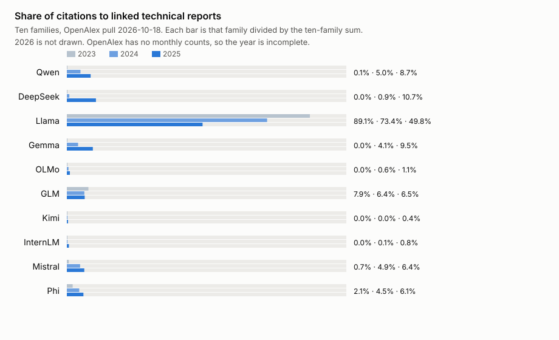

# Technical reports and repository activity of ten open model families

*Evidaxis research note · OpenAlex pull 2026-10-18 · snapshot 2026-10-17 · data and code CC0-1.0*

Downloads and citations rank these families differently. The ATOM Report shows Qwen passing Llama on Hugging Face downloads in September 2025. On the OpenAlex pull of 18 October 2026, Llama's linked technical reports still drew 1,431 citations in 2025 against Qwen's 251, of 2,876 for all ten families; Llama 2 and Llama 3 are excluded (see below), so Llama's lead is understated. Partial-year counts can only grow; 2026 is not otherwise compared.



| Family | Reports in the sum | 2023 | 2024 | 2025 | 2026 partial | Share 2023 | Share 2024 | Share 2025 | Org repos | Median commits/week | Sum of commits/week |
|---|---:|---:|---:|---:|---:|---:|---:|---:|---:|---:|---:|
| Qwen | 23 of 23 | 1 | 131 | 251 | 325 | 0.1% | 5.0% | 8.7% | 10 | 0.75 | 513.6 |
| DeepSeek | 3 of 4 | 0 | 24 | 307 | 167 | 0.0% | 0.9% | 10.7% | 4 | 0 | 1334 |
| Llama | 1 of 3 | 957 | 1923 | 1431 | 210 | 89.1% | 73.4% | 49.8% | 1 | 0 | 0 |
| Gemma | 4 of 4 | 0 | 108 | 274 | 129 | 0.0% | 4.1% | 9.5% | 3 | 0 | 0.8 |
| OLMo | 2 of 2 | 0 | 16 | 32 | 23 | 0.0% | 0.6% | 1.1% | 1 | 0 | 0 |
| GLM | 4 of 4 | 85 | 168 | 188 | 21 | 7.9% | 6.4% | 6.5% | 3 | 0.1 | 0.6 |
| Kimi | 3 of 3 | 0 | 0 | 12 | 8 | 0.0% | 0.0% | 0.4% | 1 | 0 | 0 |
| InternLM | 1 of 1 | 0 | 3 | 22 | 4 | 0.0% | 0.1% | 0.8% | 7 | 0 | 22.3 |
| Mistral | 2 of 2 | 8 | 127 | 184 | 143 | 0.7% | 4.9% | 6.4% | not found | not found | not found |
| Phi | 7 of 7 | 23 | 119 | 175 | 74 | 2.1% | 4.5% | 6.1% | 1 | 1.8 | 1.8 |

A zero in a citation column is a measured zero on a linked report. `not found` is a gap.
The share is that family's citations divided by `denominator_{year}` in `families.csv`.
For 2025 the denominator is 2876. Share columns for 2026 are in the CSV and are not used above.

## What was counted

Ten families named in the ATOM Report's regional list (Section 2.2) and kept as this
package's set: Qwen, DeepSeek, Llama, Gemma, OLMo, GLM, Kimi, InternLM, Mistral, and Phi.
ATOM measures model weights on Hugging Face. This note measures citations of the families'
technical reports, and commit activity of organization repositories in one Evidaxis snapshot.

**Reports.** Each family has a fixed list of generation reports (arXiv ids in `build.py`)
plus every arXiv hit whose title leads with the family name and says "technical report"
within the first six words. Derivative titles that only contain the name later, such as
Lawyer LLaMA and the FoundationAI Llama reports, stay in `reports.csv` as
`title_search_excluded` and are not in the sums. 5 titles are excluded that way.
Qwen-Image is arXiv `2508.02324`, from the Qwen title search.

**OpenAlex link.** Each report is looked up at `https://api.openalex.org/works/doi:10.48550/arXiv.<id>`.
A count is kept only when the title matches the arXiv title after normalization (case, punctuation, and spaces).
A matching DOI is not enough. An arXiv id in `ids` or `locations` does not keep a work whose title is a different paper. That work is `contaminated`, and the count is not used.
A contaminated report is searched with `https://api.openalex.org/works?filter=title.search:<title>`.
A hit is kept only when the normalized title and the publication year both match. Otherwise the report stays out of the sum.
When a preprint and a version of record both match and are separate OpenAlex works, the higher `cited_by_count` is kept and the two are not added.
A work that carries the arXiv DOI together with any other publisher DOI is a contaminated merge: its count is not used, and a same-title work with 0 citations is not entered as zero.
The journal DOI named on the arXiv record is checked as a version of record and is kept only when the title matches.
On a linked work, OpenAlex omits a year that has no citations. Those years are 0 in the sum.
`counts_by_year` has a year and a count. It has no month. 2026 is therefore not compared with the same months of 2025.

**Reports outside the sum.** Every canonical or title-search report that is not in the sum has a `why` cell in `reports.csv`.

- `2501.12948` (DeepSeek, DeepSeek-R1: Incentivizing Reasoning Capability in LLMs via Reinforcement Learning). OpenAlex tied this arXiv id to «Can Open Large Language Models Catch Vulnerabilities?» and «DeepSeek-R1 incentivizes reasoning in LLMs through reinforcement learning». Neither title matches. Ids or locations name this arXiv id. That does not make the work this report. That count is not used. OpenAlex merges doi:10.48550/arXiv.2501.12948 with unrelated DOI(s): 10.4230/oasics.icpec.2025.4. Title search found no OpenAlex work with this title and publication year 2025. The report stays out of the sum.
- `2307.09288` (Llama, Llama 2: Open Foundation and Fine-Tuned Chat Models). OpenAlex tied this arXiv id to «Behavioral Safety and Context Retention of Large Language Models in a Longitudinal ICU Simulation under Offline Conditions». The title does not match. Ids or locations name this arXiv id. That does not make the work this report. That count is not used. Title search found no OpenAlex work with this title and publication year 2023. The report stays out of the sum.
- `2407.21783` (Llama, The Llama 3 Herd of Models). OpenAlex tied this arXiv id to «Enriching Location Representation with Detailed Semantic Information». The title does not match. Ids or locations name this arXiv id. That does not make the work this report. That count is not used. OpenAlex merges doi:10.48550/arXiv.2407.21783 with unrelated DOI(s): 10.4230/lipics.giscience.2025.3, 10.4230/oasics.dx.2024.25. Title search found this title in 2025, not in 2024. That work is not used. The report stays out of the sum.

Rows that stay in the sum, with a note:

- `2402.00838` (OLMo). Preprint and version of record are separate OpenAlex works. The higher cited_by_count is kept and the two are not added.

**Repositories.** From `data/snapshots/2026-10-17/snapshot.json`, organization owners only
(`etl/owner_types.json`). The owner login must be the lab: `QwenLM`, `QwenAudio`,
`deepseek-ai`, `meta-llama`, `InternLM`, `mistralai`. Gemma, OLMo, GLM, Kimi, and Phi use
the company login and a name test (`gemma`, `olmo`, `glm`, `kimi`, `phi`). Personal
accounts are not listed. `recent_weekly_commits` is the mean of the last 12 weeks of
GitHub `commit_activity` on the default branch. The slope is the log-slope of the last
26 weeks. A median of 0 can sit next to a large sum: DeepSeek's 4 repositories sum to
1334 commits/week.

## Limits

- OpenAlex's citation graph is the source. Counts were not scaled to any other index.
- 2026 runs through the pull on 2026-10-18 and is not a finished year.
- The archive is the Evidaxis registry of code systems, not a full list of each lab's
  repositories. Llama's only match is `meta-llama/prompt-ops`.
- Default branch only. Work on other branches is outside this snapshot.
- The old DOI filter responses remain in `raw/openalex/doi-*.json` and `title-*.json`.
  The sums read `bydoi-*.json`, `sametitle-*.json`, `vordoi-*.json`, and `titlesearch-*.json`.

## Correction 2026-10-18

The first version, commit e88cf7fbc0, linked Llama 2 (arXiv 2307.09288) by DOI to an OpenAlex work about an ICU simulation.
That work's title is not the Llama 2 report. Its citations were still counted, including 808 in 2025.
Llama's 2025 total in that version was 2,239, against Qwen's 251, of 3,916 for all ten families.
A matching DOI is not identity. A work is now counted only when its title matches the arXiv title after normalization.
An arXiv id in ids or locations does not keep a different title. That status is `contaminated`, and the count is not used.
Each contaminated report was searched on OpenAlex by title. A hit is kept only when the title and the publication year both match.
DeepSeek citations 2023/2024/2025/2026 were 0/25/539/1046 and are now 0/24/307/167.
Llama citations 2023/2024/2025/2026 were 1205/3296/2239/376 and are now 957/1923/1431/210.
The 2025 denominator was 3,916 and is now 2,876. Shares moved with that denominator.

## Reproduce

```
python3 build.py --offline
```

`--offline` reads `raw/` and the snapshot. It does not use the network. It rewrites
`reports.csv`, `repos.csv`, `families.csv`, `chart.svg`, and this README.

`build.py --fetch` writes `raw/` from the arXiv API and OpenAlex. It needs
`OPENALEX_API_KEY` in the environment. Three tries are used so one dropped connection
does not turn a report into `not_found`. arXiv asks for 3 seconds between requests.

Standard library only.

## Cite

Evidaxis (2026). *Technical reports and repository activity of ten open model families.*
Research note, OpenAlex pull 2026-10-18, snapshot 2026-10-17.
https://github.com/evidaxis/evidaxis/tree/main/research/2026-10-open-model-families

Questions and corrections: hello@evidaxis.org
